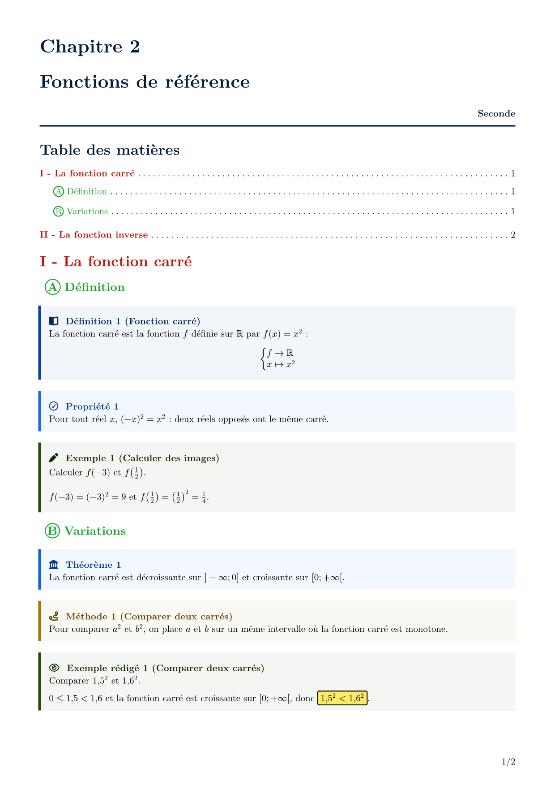

# template-perso

Mise en page de cours de mathématiques en français : boîtes numérotées
(définition, propriété, théorème, méthode, exemple…), en-tête de chapitre,
titres I / Ⓐ et table des matières assortie, réponses encadrées. Pour des
zones de réponse Seyes et des corrigés, voir
[profmaquette-minimal](https://typst.app/universe/package/profmaquette-minimal),
qui s'emploie à côté.

> **Note :** écrit d'abord pour mes propres cours, le paquet pourra évoluer de
> façon incompatible entre deux versions `0.x`.

*Maths course notes (in French): numbered boxes, chapter header, matching
headings and table of contents, highlighted answers.*



## Démarrage rapide

Nouveau projet depuis le modèle :

```bash
typst init @preview/template-perso:0.1.0
```

ou, dans un document existant :

```typ
#import "@preview/template-perso:0.1.0": *

#show: cours

#chapitre("Fonctions de référence", "Chapitre 2", "Seconde")
#toc()

= La fonction carré
== Définition

#definition(title: "Fonction carré")[
  $f(x) = x^2$ pour tout réel $x$.
]

#exemple(title: "Calculer des images")[
  $f(-3) = 9$, donc #reponse[$f(-3) = 9$].
]
```

## Commandes

| Commande | Rôle |
|---|---|
| `#show: cours` | mise en page : A4, marges 1,5 cm, numéro de page, titres, listes, liens |
| `definition`, `propriete`, `theoreme`, `proposition`, `corollaire`, `methode`, `exemple`, `exemple-redige`, `tentative-definition` | boîtes numérotées (`title:` facultatif) ; `…-block` : sans numéro |
| `chapitre(titre, numéro, classe)` | en-tête de chapitre |
| `toc()` | table des matières (`aeration:` pour l'espacement) |
| `reponse[…]`, `reponse-maths(…)` | réponse encadrée sur fond jaune |
| `fonction-accolade(f, A, x, fx)` | f : A → B et x ↦ f(x) sous une accolade |

Clés de `cours` : `police` (défaut `"New Computer Modern"`), `police-maths`
(`"New Computer Modern Math"`), `taille` (`10pt`), `langue` (`"fr"`). Par
exemple, avec les polices Kp installées :
`#show: cours.with(police: "KpRoman", police-maths: "KpMath")`.

## Remerciements

Boîtes construites avec [theorion](https://typst.app/universe/package/theorion),
icônes de [fontawesome](https://typst.app/universe/package/fontawesome).

## Licence

MIT. Voir [LICENSE](LICENSE).
